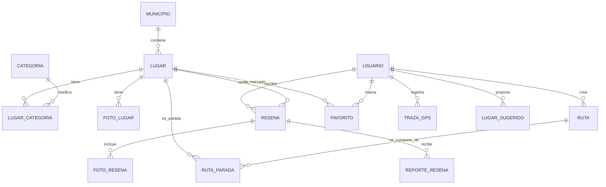

# Rutas Jinotega — Arquitectura y Plan de Proyecto

> App tipo Waze enfocada en rutas turísticas de Jinotega y sus municipios.
> Lugares conocidos y poco conocidos, reseñas reales de visitantes y GPS.
> **Stack:** .NET MAUI Blazor Hybrid (móvil) + Blazor Web + ASP.NET Core API + SQL Server.
> **Estilo UI:** glassmorphism / iOS (ver `DISENO-UI.html`).

Documento vivo: es la fuente de contexto de la sesión de diseño. Actualízalo al terminar cada fase.

---

## 1. Principios rectores

1. **Arquitectura limpia:** las dependencias apuntan siempre hacia adentro (Domain no depende de nada).
2. **Monolito modular:** módulos con límites claros dentro de una sola solución; se pueden separar a servicios después si hace falta.
3. **SOLID** en cada capa (ver sección 4).
4. **Una sola UI compartida:** componentes Razor en una Razor Class Library usados por MAUI y Web.
5. **Lo específico de plataforma, detrás de interfaces** (GPS, conectividad, almacenamiento local).
6. **Sin lógica en la UI ni en controladores:** la lógica vive en casos de uso (Application) y reglas de negocio (Domain).

---

## 2. Estructura de la solución

```
RutasJinotega.sln
├── src/
│   ├── RutasJinotega.Domain           # Entidades, value objects, reglas, eventos de dominio
│   ├── RutasJinotega.Application      # Casos de uso, puertos (interfaces), DTOs, validadores
│   ├── RutasJinotega.Infrastructure   # EF Core, repositorios, storage de fotos, proveedor de rutas
│   ├── RutasJinotega.Api              # ASP.NET Core: endpoints, auth, middleware
│   ├── RutasJinotega.Shared.UI        # Razor Class Library: páginas, componentes, CSS (glass)
│   ├── RutasJinotega.Maui             # MAUI Blazor Hybrid: GPS, offline, cámara, permisos
│   └── RutasJinotega.Web              # Blazor Web App
├── tests/
│   ├── RutasJinotega.Domain.Tests
│   ├── RutasJinotega.Application.Tests
│   └── RutasJinotega.Integration.Tests  # SQL Express real: migraciones, siembra, ruta
└── docs/
    ├── ARQUITECTURA.md
    └── DISENO-UI.html
```

### Regla de dependencias

```
Domain  <--  Application  <--  Infrastructure
                 ^                   ^
                 |                   |
        Api / Shared.UI / Maui / Web (composición: registran implementaciones)
```

- **Domain:** sin referencias a nada (ni EF, ni ASP.NET).
- **Application:** referencia solo a Domain. Define los puertos (`IRepositorioLugares`, `IServicioUbicacion`...).
- **Infrastructure:** implementa los puertos. Referencia Application.
- **Api / Maui / Web:** son la "raíz de composición" donde se hace la inyección de dependencias.
- **Shared.UI:** consume Application mediante interfaces de cliente (`ILugaresClient`), nunca EF directo.

---

## 3. Módulos de negocio

Cada módulo tiene su carpeta dentro de Domain, Application e Infrastructure.

| Módulo | Responsabilidad |
|---|---|
| **Catalogo** | Lugares, categorías, municipios, fotos, horarios |
| **Rutas** | Rutas curadas y personales, paradas ordenadas, distancia y duración |
| **Resenas** | Calificaciones, comentarios, fotos de visita, reportes |
| **Identidad** | Usuarios, roles (Visitante, Colaborador, Moderador, Admin), perfiles |
| **Navegacion** | Seguimiento GPS, trazas (GPX), cercanía a puntos de interés |
| **Comunidad** | Lugares sugeridos, favoritos, insignias de explorador |
| **Medios** | Subida, redimensionado y almacenamiento de imágenes |

Los módulos se comunican por **interfaces o eventos de dominio**, no accediendo a tablas ajenas.

---

## 4. SOLID aplicado (guía práctica)

| Principio | Cómo se aplica aquí |
|---|---|
| **S** — Responsabilidad única | Un caso de uso = una clase (`CrearResena`, `ObtenerLugaresCercanos`). Un repositorio por agregado. Componentes Razor solo presentan. |
| **O** — Abierto/Cerrado | Nuevas categorías o proveedores de rutas se agregan implementando interfaces, sin modificar código existente (ej. `IProveedorRutas` con OSRM hoy, otro mañana). |
| **L** — Sustitución de Liskov | Cualquier `IServicioUbicacion` (MAUI, Web, simulado) funciona igual para los casos de uso. Mismos contratos y excepciones. |
| **I** — Segregación de interfaces | Interfaces pequeñas: `ILectorLugares` y `IEscritorLugares` separados; no un `IRepositorio` gigante. |
| **D** — Inversión de dependencias | Application define interfaces; Infrastructure las implementa. Todo se inyecta por constructor. |

### Reglas anti-espagueti

- Máximo ~20 líneas por método; si crece, se extrae.
- Nada de `if (plataforma == ...)` en lógica de negocio; se resuelve con DI.
- Los componentes Razor no llaman a `HttpClient` directamente; usan clientes tipados.
- Validación en Application (FluentValidation), reglas invariantes en Domain.
- Mapeo explícito Entidad ↔ DTO (Mapster o mapeadores manuales), nunca exponer entidades en la API.
- Nombres de dominio en español (`Lugar`, `Ruta`, `Resena`) para consistencia con el negocio.
- Un caso de uso devuelve un `Resultado<T>` (éxito/error) en vez de lanzar excepciones para flujo normal.

### Patrones recomendados

- **CQRS ligero:** comandos (escriben) y consultas (leen) separados, con handlers simples.
- **Repository + Unit of Work** (el `DbContext` actúa como UoW).
- **Specification** para consultas reutilizables (lugares por municipio, por categoría, cercanos).
- **Result pattern** para errores esperados.
- **Options pattern** para configuración (claves de mapas, storage).

---

## 5. Modelo de datos relacional (SQL Server)

Usa tipos espaciales (`geography`) con NetTopologySuite para consultas por cercanía.



### Tablas principales

| Tabla | Campos clave |
|---|---|
| **Municipio** | Id, Nombre, Descripcion, Limite (geography, opcional) |
| **Categoria** | Id, Nombre, Icono, Color |
| **Lugar** | Id, MunicipioId (FK), Nombre, Descripcion, Ubicacion (geography Point), Direccion, Horario, DificultadAcceso, EsPocoConocido (bit), Estado (Activo/Oculto), PromedioCalificacion, TotalResenas, CreadoEn |
| **LugarCategoria** | LugarId, CategoriaId (PK compuesta) |
| **FotoLugar** | Id, LugarId, Url, Orden, UsuarioId |
| **Ruta** | Id, Nombre, Descripcion, EsCurada (bit), CreadaPorUsuarioId, DistanciaKm, DuracionMin, Dificultad, Estado |
| **RutaParada** | Id, RutaId, LugarId, Orden, TiempoEstimadoMin, Nota |
| **Usuario** | Id (ASP.NET Identity), Nombre, FotoPerfil, Rol, CreadoEn |
| **Resena** | Id, LugarId, UsuarioId, Calificacion (1–5), Comentario, FechaVisita, CreadoEn, Estado (Publicada/Oculta) |
| **FotoResena** | Id, ResenaId, Url |
| **ReporteResena** | Id, ResenaId, UsuarioId, Motivo, Estado |
| **Favorito** | UsuarioId, LugarId (PK compuesta), CreadoEn |
| **TrazaGps** | Id, UsuarioId, RutaId (nullable), Puntos (geography LineString), InicioEn, FinEn |
| **LugarSugerido** | Id, UsuarioId, Nombre, Ubicacion, Descripcion, Estado (Pendiente/Aprobado/Rechazado) |

### Reglas de integridad

- Un usuario solo puede dejar **una reseña por lugar** (índice único `LugarId + UsuarioId`).
- `PromedioCalificacion` y `TotalResenas` se actualizan por evento de dominio al crear/editar/ocultar reseñas.
- Índice espacial en `Lugar.Ubicacion`.
- Borrado lógico (`Estado`) en lugar de borrado físico para lugares y reseñas.
- Migraciones con EF Core, versionadas en Git.

---

## 6. Decisiones técnicas

| Tema | Decisión | Motivo |
|---|---|---|
| UI compartida | RCL con componentes Razor | Una sola UI para MAUI y Web |
| Base de datos | SQL Server + NetTopologySuite | Relacional y consultas por distancia |
| ORM | EF Core | Productividad y migraciones |
| Mapas | Leaflet + OpenStreetMap | Sin costo por uso ni API key; MapLibre como alternativa si se requiere offline |
| Rutas | Distancia recta entre paradas (Haversine); proveedor externo cuando se necesite navegación giro a giro | No construir navegación desde cero |
| Offline (móvil) | SQLite local + sincronización | Zonas rurales sin señal |
| Auth | ASP.NET Identity + JWT | Estándar, soporta MAUI y Web |
| Fotos | Blob storage (Azure Blob o R2) | No guardar binarios en SQL |
| Validación | FluentValidation | Reglas separadas de entidades |
| Pruebas | xUnit + FluentAssertions + Testcontainers | Aislar y probar casos de uso |

---

## 7. Estilo visual (resumen)

Detalle completo y vista previa en `DISENO-UI.html`.

- **Glassmorphism / iOS:** superficies translúcidas con `backdrop-filter: blur`, bordes finos claros, sombras suaves, esquinas muy redondeadas.
- **Paleta:** verdes de montaña y café de Jinotega, con acento cálido.
- **Tipografía:** sistema iOS (`-apple-system`, SF Pro) con fallback a Inter.
- **Componentes base:** tarjeta de lugar, hoja inferior (bottom sheet) sobre el mapa, barra de pestañas flotante, chips de categoría, estrellas de calificación.
- Todo el CSS vive en `Shared.UI/wwwroot/css` con variables (design tokens), nada de estilos sueltos por página.

---

## 8. Roadmap por fases

### Fase 0 — Fundamentos
- [x] Crear solución y proyectos con la estructura de la sección 2
- [x] Configurar referencias y regla de dependencias (analizador de arquitectura opcional: NetArchTest, pendiente)
- [x] Configurar EF Core y SQL Server con migraciones versionadas (`Persistencia/Migraciones`)
- [ ] CI básico (build + tests)
- [x] Design tokens y componentes glass base en Shared.UI

### Fase 1 — MVP de catálogo (solo lectura)
- [x] Entidades Municipio, Categoria, Lugar, FotoLugar
- [x] Casos de uso: listar lugares, filtrar por municipio/categoría, ver detalle, lugares cercanos
- [x] Pantalla de mapa de calles con pines + hoja inferior de detalle (Leaflet + OpenStreetMap, con respaldo esquemático)
- [~] Carga inicial de datos (seed): 12 lugares; Tepeyac, iglesia y catedral verificados, mini pulperías aún de **ejemplo**
- [~] Mismo flujo en MAUI (Android primero) y Web: código escrito, **sin probar en dispositivo/navegador**

### Fase 2 — Cuentas y reseñas
- [ ] Registro/login (Identity + JWT)
- [ ] Reseñas con calificación, comentario, fecha y fotos
- [ ] Favoritos
- [ ] Moderación básica (reportar/ocultar)

### Fase 3 — Rutas y GPS
- [x] Rutas curadas con paradas ordenadas (API `GET /api/rutas/{clave}` y pantalla `/rutas`; datos de ejemplo)
- [ ] Servicio de ubicación en MAUI (`IServicioUbicacion`)
- [ ] Seguimiento en vivo y aviso al acercarse a un punto
- [ ] Integración con proveedor de rutas / abrir en app de navegación

### Fase 4 — Offline y comunidad
- [ ] SQLite local, descarga de mapas y rutas
- [ ] Sincronización diferida de reseñas y trazas
- [ ] Lugares sugeridos por usuarios + flujo de aprobación
- [ ] Insignias de explorador

### Fase 5 — Crecimiento
- [ ] Alianzas con negocios locales (hoteles, guías, cafeterías)
- [ ] Multi-idioma (ES/EN)
- [ ] Publicación en tiendas

---

## 9. Siguientes pasos inmediatos

1. Restaurar paquetes y compilar toda la solución en tu máquina (`dotnet build`) y corregir lo que aparezca.
2. Ejecutar los tests (`dotnet test RutasJinotega.sln`); las migraciones ya están generadas.
3. Probar API + Web, y luego MAUI en emulador Android.
4. Reemplazar los datos de ejemplo por lugares reales de Jinotega y sus municipios (coordenadas verificadas).
5. Evaluar MapLibre + teselas propias si se necesita mapa offline o sin CDN.
6. Empezar la Fase 2: Identity + JWT y reseñas.

---

## 10. Registro de decisiones y sesión

| Fecha | Decisión |
|---|---|
| 2026-11-19 | App tipo Waze turística para Jinotega y municipios; MAUI Blazor Hybrid + Blazor Web |
| 2026-11-19 | Arquitectura limpia, monolito modular, SOLID, base de datos relacional |
| 2026-11-19 | Estilo visual glassmorphism / iOS |
| 2026-11-19 | Documentación en MD (arquitectura) y HTML (diseño UI) |

### Preguntas abiertas
- ¿Basta Leaflet/OSM o se necesita Google Maps por precisión de direcciones?
- ¿Dónde se aloja el backend y las fotos (Azure, otro proveedor)?
- ¿Las reseñas requieren verificar que el usuario realmente visitó el lugar (por GPS)?
- ¿Solo español al inicio?

---

## 11. Estado de implementación (2026-11-23)

**Alcance entregado:** Fase 0, Fase 1 (MVP de catálogo, solo lectura) y primera rebanada de Fase 3 (ruta curada de San Rafael).

### Ruta turística San Rafael

- Backend: `Ruta`/`RutaParada`, `ILectorRutas`, `ObtenerRutaHandler`, `GET /api/rutas/{clave}`.
- La ruta `san-rafael` va de mini pulperías al Tepeyac, pasando por la iglesia del municipio. Son 5 paradas y ~1.2 km calculados con Haversine.
- Frontend: página `/rutas` con mapa de calles, línea de ruta, lista de paradas y hoja de detalle; en escritorio el mapa queda fijo a la izquierda y las paradas a la derecha.
- Nombres y coordenadas de las mini pulperías siguen siendo **datos de ejemplo**; el Tepeyac, la iglesia de San Rafael y la catedral de Jinotega ya usan coordenadas de OSM e historia documentada.

### Mapa

- `MapaCalles.razor` + `wwwroot/js/mapa-calles.js` cargan Leaflet 1.9.4 y teselas de OpenStreetMap desde CDN, dibujan marcadores, tooltips y la polilínea de la ruta.
- Si el script o la red fallan, se renderiza el mapa esquemático anterior; `MapaRuta` y `MapaLugares` son adaptadores sobre el mismo componente.
- Requiere internet en el navegador; no hay caché offline todavía.

### Esquema y pruebas de base de datos

- `Persistencia/Migraciones` contiene la migración `Inicial`; la API aplica migraciones pendientes y luego siembra.
- `InicializadorBaseDatos` crea una línea base para bases previas a las migraciones y agrega `Lugar.Historia` sin borrar datos.
- `SembradorDatos` hace upsert por nombre + municipio y refresca contenido editorial y coordenadas, por lo que es idempotente.
- `tests/RutasJinotega.Integration.Tests` corre contra SQL Express real: base única por ejecución, migraciones, siembra repetida, ruta y contenido histórico.

### Qué se verificó y qué no

| Parte | Estado | Cómo se comprobó |
|---|---|---|
| Domain | Compila; 28 tests correctos | `dotnet build` y `dotnet test` reales (SDK 10) |
| Application | Compila; 20 tests correctos | `dotnet build` y `dotnet test` reales |
| Shared.UI (Razor) | Compila, 0 errores | `dotnet build` real |
| Infrastructure (EF Core) | Migraciones y siembra contra SQL Express | Arranque real de la API + migración aplicada |
| Api, Web, MAUI | Compilan (MAUI con avisos MA002) | `dotnet build` de la solución |
| Tests xUnit | 54 de 54 correctos (28 + 20 + 6 integración) | `dotnet test RutasJinotega.sln` |
| API en ejecución | `GET /api/rutas/san-rafael` responde 5 paradas, 1.2 km | Consulta HTTP real |
| Web en ejecución | `/rutas` con teselas OSM, 5 marcadores, selección y detalle con historia | Navegador integrado |
| Escritorio | Rejilla de 2 columnas y mapa sticky a 800 px de ancho | Navegador integrado |
| MAUI en dispositivo | No verificado | Falta emulador/dispositivo |

### Limitaciones actuales

1. **Datos de la ruta:** nombres y coordenadas de mini pulperías son de ejemplo; faltan verificarlos en campo.
2. **Mapa:** depende de CDN y red; el respaldo esquemático no muestra calles reales. Falta evaluar MapLibre + teselas propias si se requiere offline.
3. **Rutas:** la definición de la ruta vive en `LectorRutas`; aún no se persiste ni se administra desde la base de datos.
4. **MAUI:** requiere workload y Android SDK; falta probar la pantalla de rutas en emulador o dispositivo.

### Decisiones tomadas al implementar (difieren o precisan el diseño)

| Tema | Decisión | Motivo |
|---|---|---|
| Ubicación en BD | Dos columnas `Latitud`/`Longitud` (double) en vez de `geography` | MVP sin dependencia de NetTopologySuite; el prefiltro por cuadrante + Haversine exacto cubre cientos de lugares. Migrar a `geography` + índice espacial cuando crezca el catálogo. |
| Web | Blazor WebAssembly standalone (no Blazor Web App) | Misma UI compartida con MAUI y API separada. |
| Casos de uso | `IConsultaHandler<TConsulta, TRespuesta>` sin mediador | Simple, testeable, sin dependencias. |
| Errores | `Resultado<T>` + `Error` con código | Sin excepciones en flujo normal; la API los traduce a HTTP en un solo lugar (`ResultadoHttp`). |
| Mapa | Leaflet + OpenStreetMap con respaldo esquemático | Calles reales sin API key ni backend propio; el respaldo mantiene la app usable sin red. |
| Contenido histórico | `Lugar.Historia` en la misma entidad | Un campo editorial por lugar evita una tabla de contenidos para el MVP. |
| Esquema | Migraciones EF + línea base automática | Las bases creadas con `EnsureCreated` no se rompen al agregar columnas. |
| Navegación | Botón "Ir con GPS" abre la ruta en Google Maps | No construir navegación giro a giro desde cero. |
| Datos semilla | 12 lugares; solo mini pulperías marcadas "(Ejemplo)" | Coordenadas reales donde se pudieron verificar; no inventar el resto. |

### Preguntas abiertas (siguen pendientes)
- ¿Basta Leaflet/OSM o hace falta Google Maps?
- ¿Dónde se aloja el backend y las fotos?
- ¿Las reseñas requieren verificar la visita por GPS?
- ¿Solo español al inicio?
